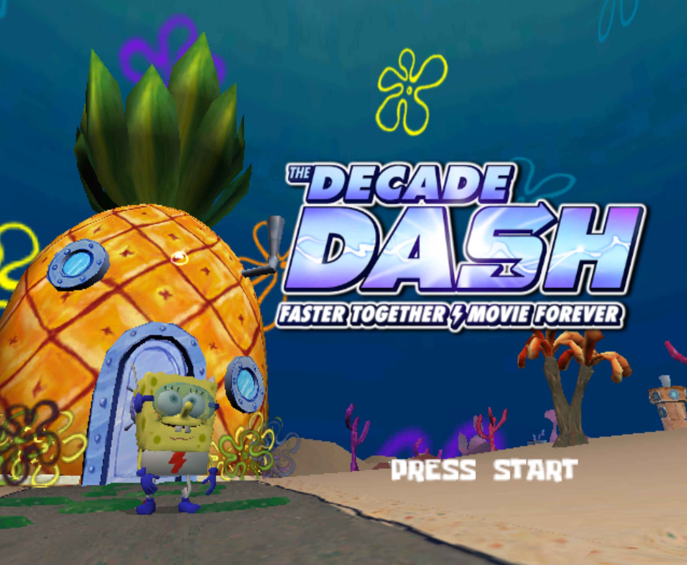

<div align="center">

<h1 align="center">Welcome to the Decade Dash!</h1>
</div>

## About The Project



This mod for SpongeBob SquarePants: Battle for Bikini Bottom adds 400 new spatulas to the game, totaling 500 spatulas.
This includes new spatulas in existing areas, as well as new areas altogether.<br />

Spatulas are tracked in the hub above the entrance to the corresponding level. Hub spatulas are above SpongeBob's door.<br />


You can warp back to these individual level spatula counts at any time using the pause menu.<br />


Socks are also tracked in the pause screen as usual with updated counts.<br />


If you would like, we also have available [this tracker](https://docs.google.com/spreadsheets/d/1VpgPCoxyAG9j2f7czXRDyfUMownRdPRENgg4ej880R8/edit?usp=sharing) from the Twitch Plays iteration. Note that this is more in-depth, but might save you some time if you're going for 100%.

In addition to all the new spatulas, we have also added 15 CREO cards for you to find! After finding them, you may view the artwork in the robot viewer in the police station.
(Each CREO card is associated with a spatula, so don't worry about having to search for them separately.)<br />


And, of course, the three playable characters get new costumes! Enjoy playing as The Quickster, The Elastic Waistband, and Miss Appear!<br />


We hope you enjoy the mod! It was a labor of love, so please enjoy our hard work at long last.<br />

Sincerely,<br />
TetraxZ and Sleepyhead08 :)


### Installation

If you are on Xbox:
1. Obtain a copy of the Xbox ROM of Battle for Bikini Bottom (not provided for legal reasons)
2. Extract the ROM to a folder.
3. Patch the default.xbe file with the provided XboxPatch.ips file using [this online patcher](https://www.ff6hacking.com/patcher/).
4. Place the provided modded hip/hop files into the extracted folder.
5. If you are on emulator, use [extract-iso](https://github.com/xboxdev/extract-xiso) to pack the folder back into an iso file.
 ```sh
  extract-xiso.exe -c <XBOX_FOLDER>
  ```

If you are on GameCube:
1. Obtain a copy of the GameCube ROM of Battle for Bikini Bottom (not provided for legal reasons)
2. Extract the ROM to a folder.
3. Patch the main.dol file with the provided GameCubePatch.ips file using [this online patcher](https://www.ff6hacking.com/patcher/).
4. Place the provided modded hip/hop files into the extracted folder.
5. If you are on emulator, add the sys folder to your game folder paths.

### Built With

* [IndustrialPark](https://github.com/igorseabra4/IndustrialPark)
* [Blender](https://www.blender.org/)
* [Heavy Iron Modding Tools](https://github.com/Redberd36/Heavy-Iron-Modding-Tool-Package-5.0.1)

### Special Thanks
* ColPun
* wosawinda
* estrangr
* Sophia_1543
* Shell
* The Titans of the Tide Speedrunning Discord

