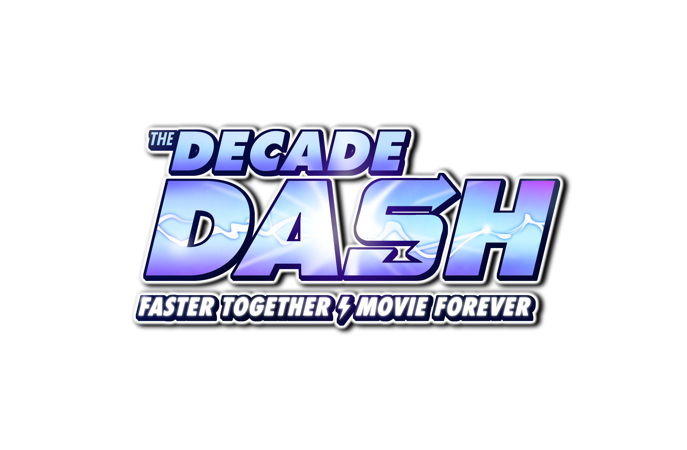
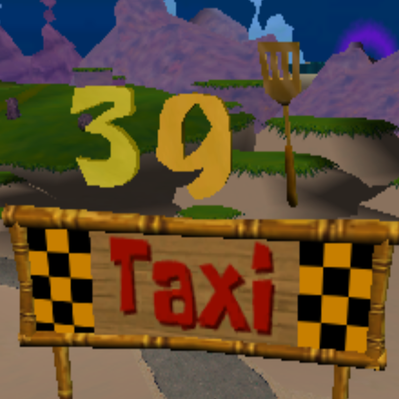
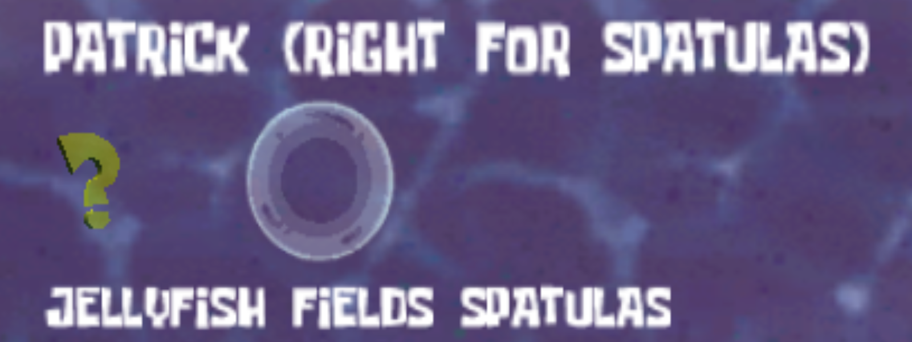
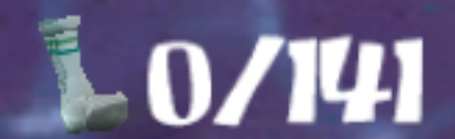
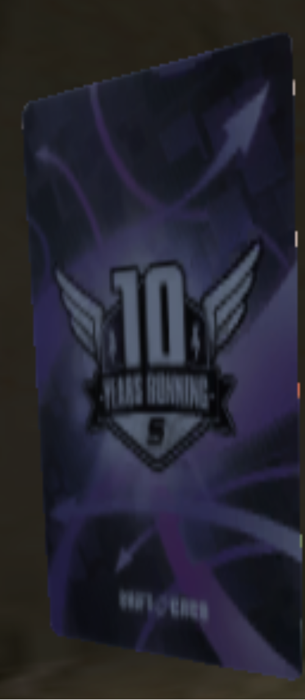
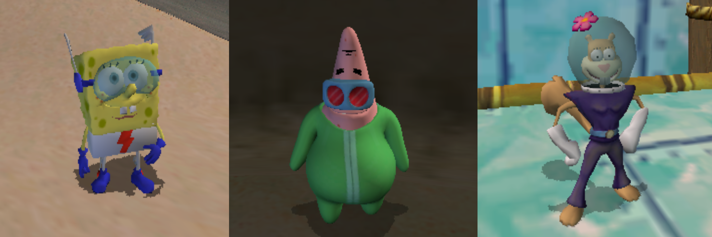

<h1 align="center">Welcome to the Decade Dash!</h1>

This mod for SpongeBob SquarePants: Battle for Bikini Bottom adds 400 new spatulas to the game, totaling 500 spatulas.
This includes new spatulas in existing areas, as well as new areas altogether. 

Spatulas are tracked in the hub above the entrance to the corresponding level. Hub spatulas are above SpongeBob's door. 

You can warp back to these individual level spatula counts at any time using the pause menu. 

Socks are also tracked in the pause screen as usual with updated counts. 

If you would like, we also have available [this tracker](https://docs.google.com/spreadsheets/d/1VpgPCoxyAG9j2f7czXRDyfUMownRdPRENgg4ej880R8/edit?usp=sharing) from the Twitch Plays iteration. Note that this is more in-depth, but might save you some time if you're going for 100%.

In addition to all the new spatulas, we have also added 15 CREO cards for you to find! After finding them, you may view the artwork in the robot viewer in the police station.
(Each CREO card is associated with a spatula, so don't worry about having to search for them separately.) 

And, of course, the three playable characters get new costumes! Enjoy playing as The Quickster, The Elastic Waistband, and Miss Appear! 

We hope you enjoy the mod! It was a labor of love, so please enjoy our hard work at long last. 

Sincerely, 
TetraxZ and Sleepyhead08 :)

### Installation

This mod has both Xbox and GameCube versions. The installation process is the same for both.

1. Obtain a copy of the Battle for Bikini Bottom .iso for your preferred platform (not provided for legal reasons).
2. Download the mod .zip for your chosen platform from the Releases tab. Do not extract it.
2. Download and extract the Heavy Mod Manager from the Releases tab. This is a branch of the original [Heavy Mod Manager](https://github.com/igorseabra4/HeavyModManager/releases) with [multi-platform support](https://github.com/igorseabra4/HeavyModManager/tree/multi-platform-support).
3. Run HMM and Create a Backup of BfBB for your platform of choice. (Choose your platform, then select your .iso.)
4. Click Add Mods and select the mod .zip you downloaded in Step 2.
5. From here, you may use HMM to build a modded .iso or launch the modded game directly in emulator.

Note that due to the nature of modding, we cannot distribute the files of the original game. The mod .zips are merge files that HMM will merge into your provided game files.
These merge files as well as the patches included in the mods are available in the repository code. (Please do not use these to install the game, as some were too big to upload. The .zips contain everything you need.)

If needed there is a more [in-depth tutorial of Heavy Mod Manager](https://heavyironmodding.org/wiki/Heavy_Mod_Manager).

### Built With

* [IndustrialPark](https://github.com/igorseabra4/IndustrialPark)
* [Blender](https://www.blender.org/)
* [Heavy Iron Modding Tools](https://github.com/Redberd36/Heavy-Iron-Modding-Tool-Package-5.0.1)

### Special Thanks
* ColPun
* wosawinda
* estrangr
* Sophia_1543
* Shell
* The Titans of the Tide Speedrunning Discord

